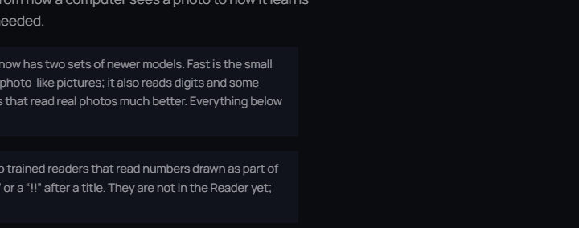
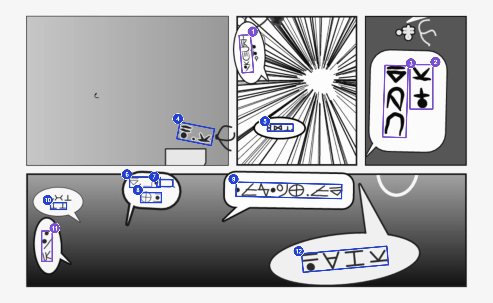
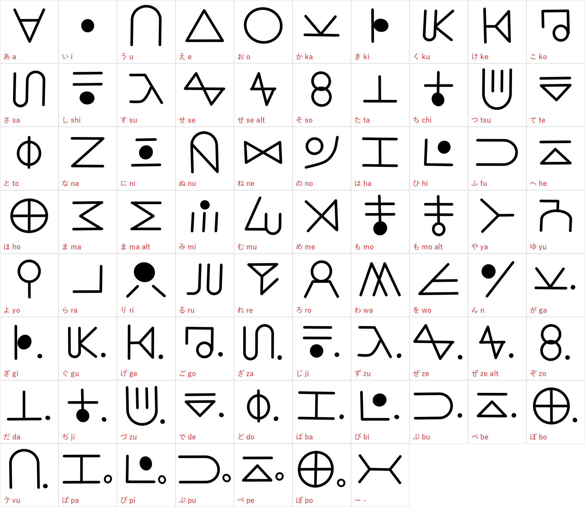
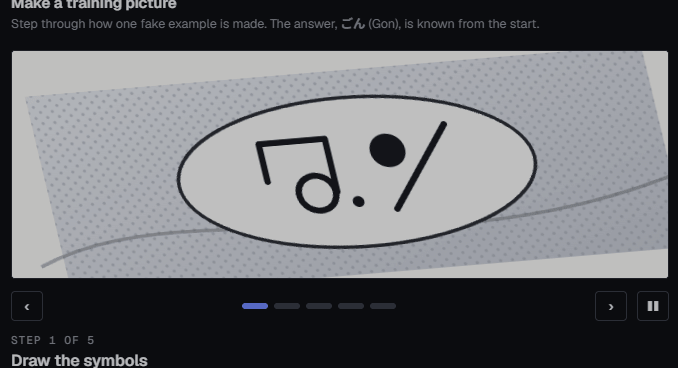
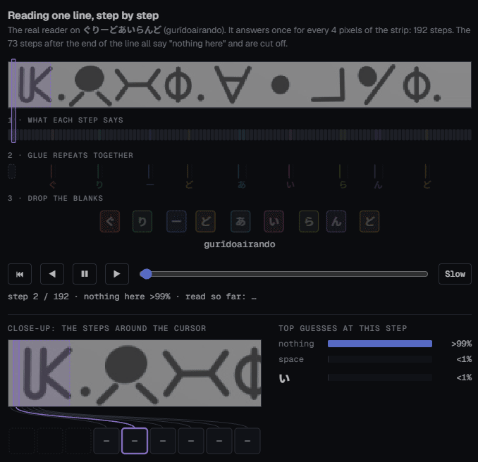
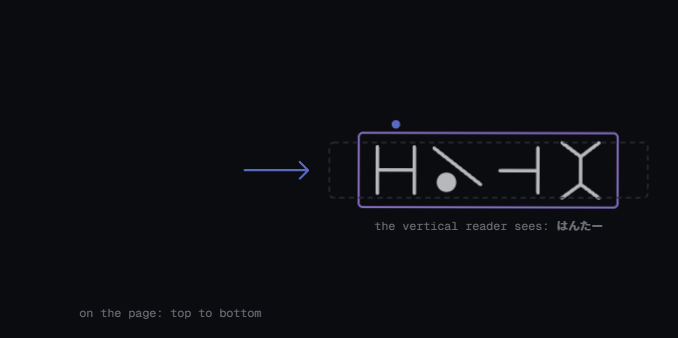

# HxH OCR

**To our knowledge, the first OCR for the Hunter × Hunter alphabet** (ハンター文字), the
invented script that the manga and anime use for signs, letters and title cards. It finds the
lines on a page, reads horizontal lines and vertical columns, and outputs hiragana and romaji.
Everything runs in the browser on a small Rust engine compiled to WebAssembly, with int8
models: a **Fast** set of about 1 MB for the live camera and phones, and an **Accurate** set of
3.6 MB for still images. Nothing is uploaded.



*Each symbol stands for one kana; together they spell hantā raisensu, "Hunter License". The
animations in this README are recorded from the
[How it works](https://hxh-ocr.kokkakniphon.workers.dev/blog/) page.*

**Try it:** https://hxh-ocr.kokkakniphon.workers.dev (whole pages, tap a line, live camera)

**On your phone:** [HxH Translator](https://hxhtranslator.com), a fan web app built on these
models. Read points your camera at Hunter script and reads it, Write types kana in the script on
a 12-key pad, and Learn teaches the alphabet with a quiz. The app's own code is not in this
repository.

**On a Nintendo DSi:** [HxH Translator for DSi](https://kokkakniphon.itch.io/hxh-translator-dsi), a free homebrew port on itch.io
with the same three modes. Read takes a picture with the DSi's camera and reads it with the small
`dsi_v1` reader on the console's own processor ([how it was made](https://hxh-ocr.kokkakniphon.workers.dev/blog/dsi)). Its code is not public
either.



*The browser pipeline on a generated validation page. Each box is one detected line, numbered
in reading order; purple boxes are vertical columns. The page is generated, like all the data
in this repository.*

The script is a one-to-one cipher for Japanese kana: 46 kana plus the long-vowel mark, with a
small dot (dakuten) or ring (handakuten) for voiced sounds. No labelled data existed, so every
model here is trained on generated images. A search of the web, GitHub and Hugging Face on
2026-11-25 found tools that turn typed text into the script, and none that reads it from
images.

- **How it works, for everyone:** https://hxh-ocr.kokkakniphon.workers.dev/blog/
- **Research deep dive** (every ablation, including the failures; it covers the first, `v4`
  models): https://hxh-ocr.kokkakniphon.workers.dev/blog/deep-dive
- **Lab notebook:** [`docs/research/JOURNAL.md`](docs/research/JOURNAL.md), the full log with
  every decision and number, in order.
- **Models and datasets on Hugging Face:**
  [`KokkakNiphon/hxh-ocr`](https://huggingface.co/KokkakNiphon/hxh-ocr) (models),
  [`KokkakNiphon/hxh-ocr-lines`](https://huggingface.co/datasets/KokkakNiphon/hxh-ocr-lines)
  and [`KokkakNiphon/hxh-ocr-pages`](https://huggingface.co/datasets/KokkakNiphon/hxh-ocr-pages)
  (data).

## How it works



1. **Synthetic data.** All 47 base glyphs were traced by hand into stroke primitives and
   cross-checked against two official charts (the 2011 anime's and a printed guidebook's). A
   Python line generator (`hxh_ocr/`, four versions, each answering a measured failure) draws
   lines in clean, handwritten and brush styles on paper, screentone, gradients and noise. A
   Rust page generator (`rust/hxh-synth`) composes manga, anime-frame, document and web pages
   with exact line quadrilaterals, plus ordinary writing and icons as unlabelled negatives.
   Its fifth version adds photo-style scenes (name cards, lyric videos, screens inside anime
   frames), pages photographed off a screen (keystone, moiré, glare, blur, JPEG), outlined,
   glowing, hollow and widely spaced glyphs, and digits and punctuation inline; it also cuts
   reader training lines out of its pages exactly the way the browser does. Ordinary writing
   is rendered only with openly licensed fonts (OFL-1.1 and Apache-2.0, pinned by hash in
   `rust/hxh-synth/fonts.lock.json`).

   

   *How one training picture is made: clean strokes, drawn by hand, a background, a tilt, then
   blur and grain. The generators pick every setting at random.*
2. **Models.** A DBNet-style line detector and two CTC line readers (one for horizontal lines,
   one for vertical columns turned on their side), on ImageNet-pretrained MobileNetV4-small
   backbones restricted to convolutions and ReLU. They come as a small family:

   | set | detector | readers | in the demo |
   |---|---|---|---|
   | `v4` (75 classes) | `det_v2`, 640 px, 350k params, 1.57 G MACs | `qat_v4_mnv4s_h48`, `_vert`: 323k params, 154 M MACs per line | the first models; `det_v2` stays in Fast |
   | `tiny` (91 classes) | `det_tiny_v3_qat`: `det_v2` retrained with photo-style pages | `qat_fam_tiny_h48`, `_vert`: the v4 readers retrained | Fast's vertical reader |
   | `base` (91 classes) | `det_base_v1_qat`: MobileNetV4-small 1.0, 960 px, 1.18M params, 4.44 G MACs | `qat_fam_base_h48`, `_vert`: 1.18M params, 555 M MACs per line | Accurate's detector and vertical reader |
   | `tiny_v7` (92 classes) | `det_v2` | `qat_v7dh_tiny_h48`: the tiny reader retrained for numbers drawn in the lettering and the cross `×`, with the tiny vertical reader | **Fast** |
   | `base_v7` (92 classes) | `det_base_v1_qat` | `qat_v7bs_base_h48`: the base reader, likewise, with the base vertical reader | **Accurate** |

   The family readers know 90 tokens: the 74 of the `v4` readers (hiragana, ー, space) and
   `0-9 ! ? : / . -`. The v7 horizontal readers add a 91st, the cross `×` that separates the
   words of the anime's episode titles ("A×ト×B"); in this alphabet the long-vowel mark `ー` is
   a stretched X, so earlier readers read the cross as `ー`. Fast also looks at overlapping
   tiles of a big photo; Accurate reads still images in one pass at 960 px; the live camera
   always uses Fast.

   A much smaller reader, `dsi_v1` (the first three stages of the tiny backbone, 32 × 512 px,
   30.6 M MACs a line, 104 KB in int8), was made for [HxH Translator for DSi](https://kokkakniphon.itch.io/hxh-translator-dsi). Its
   weights are in the model repo on Hugging Face (`int8/dsi_v1`); the port's code is not public.

   

   *The real reader on a real strip, one step at a time. It answers once for every 4 pixels (192
   steps): row 1 is what each step says, row 2 glues repeats together, row 3 drops the "nothing
   here" steps (CTC decoding). Below: the steps around the cursor and the top guesses at each.*

   

   *A vertical column is turned a quarter turn, first symbol on the left, and read by the
   vertical reader.*
3. **int8.** Quantisation-aware training reproduces Espressif's ESP-DL rules (per-tensor
   power-of-two scales, half-up rounding), then ESP-PPQ quantises. `hxh-infer`, a `no_std`
   Rust engine with no dependencies, reproduces ESP-PPQ's integer simulation bit for bit and
   runs at about 25 GMAC/s on one thread with WASM SIMD. `hxh-detect` turns the detector's maps
   into lines in reading order and rectified crops.

## Results

Every number below is measured on generated images the models did not train on. There is no
published real-image benchmark (see Limitations).

**Pages, end to end** (the browser pipeline in node, int8, with the demo's filters: reading
confidence 0.8 and detector score 0.55; a detected line matches at quadrilateral IoU ≥ 0.5;
CER counts missed lines in full; raw output and the other combinations in
[`experiments/family/eval/`](experiments/family/eval)):

| test pages | `v4` F1 | **Fast** F1 | **Accurate** F1 | Accurate CER h / v | Accurate CER of found lines |
|---|---|---|---|---|---|
| `pages_v5` val[900:1000]: photo-style (100 pages, 669 lines) | 75.5% | 76.8% | **83.6%** | 19.9% / 57.8% | 2.4% |
| `pages_v3o` val[900:1000]: mixed pages (100 pages, 1,063 lines) | 85.8% | 86.6% | **91.7%** | 10.4% / 14.8% | 2.9% |
| `pages_foreign_open`: mostly not Hunter script (150 pages, 697 lines) | 92.5% | 93.5% | **96.7%** | 4.2% / 7.5% | 1.3% |
| `pages_v2` val[900:1000]: Hunter script only (100 pages, 1,657 lines) | 89.5% | 89.6% | **91.6%** | 8.2% / 16.7% | 2.1% |

Fast and Accurate are the v7 sets the demo runs; the sets they replaced (the family readers)
are in the model card and in `experiments/family/eval/`. False lines on ordinary writing stay
low: on `pages_v5`, 0.14 per page for `v4`, 0.09 for Fast and 0.01 for Accurate; on icons 0.13,
0.10 and 0.01. Vertical columns in photo-style
frames are the weak spot of every set (CER v 58-67% on `pages_v5`, mostly missed columns).

**Line readers.** On 7,444 lines cut from photo-style `v5` pages (fp32), the horizontal readers
score 18.2% CER (`v4`), 9.6% (tiny) and 8.3% (base), and read 92%, 27% and 20% of non-Hunter
crops as text. In int8 on 512 held-out lines of `synth_v4` (the older, plain line
distribution), every row bit-exact in the Rust engine:

| reader | int8 CER | `.hxhm` |
|---|---|---|
| `qat_v4_mnv4s_h48` / `_vert` | 0.84% / 0.71% | 338 KB each |
| `qat_fam_tiny_h48` / `_vert` (Fast's vertical reader) | 1.61% / 1.64% | 340 KB each |
| `qat_fam_base_h48` / `_vert` (Accurate's vertical reader) | 1.11% / 0.82% | 1.21 MB each |
| `qat_v7dh_tiny_h48` (Fast) | 1.56% | 339 KB |
| `qat_v7bs_base_h48` (Accurate) | 1.06% | 1.21 MB |

The family readers trade a little on the plain lines for half the error on photo-style ones.
On 7,018 held-out lines of the v7 cross test (2,185 of them with 3,499 crosses), int8 through
the demo's own code, Fast reads 82% and Accurate 89% of the crosses (precision 99%) where the
family readers read none, and line CER falls from 24% to 10.5% (Fast) and 8.3% (Accurate);
the price is that 2-3% of the `ー` on blurry photo-style lines come out as `×`.

**Speed** (node 24, one thread of a Ryzen 7 3700X, WASM SIMD): the 640 px detectors take 60 ms
per page and the 960 px one 190 ms; a line takes 6.0 ms with the v4 or tiny readers and 19.7 ms
with the base readers. The SIMD engine is 80 KB (31 KB gzipped).

The model card on Hugging Face has the full tables (precision, recall, every set and model).

## Quick start

### In the browser

Open the demo, or serve `web/` yourself:

```sh
cd web
python -m http.server 8000      # then open http://localhost:8000/
```

`web/ocr.js` is the whole pipeline as ES module functions on top of the wasm engine. The same
code runs in node; this reads a grayscale PGM page with the Fast set (run it next to
`web/ocr.js`, `web/hxh_infer.wasm` and `web/models/`; for the Accurate set, load the files
from `models/accurate/`):

```js
import { readFileSync } from "node:fs";
import { HxhDetector, HxhEngine, readPage, idsToText, toRomaji } from "./ocr.js";

const pgm = readFileSync(process.argv[2]);                 // binary P5, 8-bit grayscale
const [, W, H] = pgm.toString("latin1", 0, 64).match(/^P5\s+(\d+)\s+(\d+)\s+255\s/).map(Number);
const gray = new Uint8Array(pgm.buffer, pgm.byteOffset + pgm.length - W * H, W * H);

const wasm = await WebAssembly.compile(readFileSync("hxh_infer.wasm"));
const det = await HxhDetector.create(wasm, readFileSync("models/det.hxhm"));
const rec = { h: await HxhEngine.create(wasm, readFileSync("models/model.hxhm")),
              v: await HxhEngine.create(wasm, readFileSync("models/model_v.hxhm")) };
const cfg = JSON.parse(readFileSync("models/det.json", "utf8"));   // the demo's tuned settings
const vocab = JSON.parse(readFileSync("models/model.json", "utf8")).vocab;

const page = readPage(det, rec, gray, W, H, { params: cfg.params, pad: cfg.pad });
for (const l of page.lines.filter((l) => l.conf >= cfg.min_conf)) {
  const text = idsToText(l.ids, vocab);
  console.log(l.vertical ? "v" : "h", text, toRomaji(text), l.conf.toFixed(2));
}
```

In a page, fetch the same files and take the pixels from a canvas; `web/app.js` shows how,
including the Fast | Accurate switch and tiles.

### Python

Read one cropped horizontal line with an fp32 ONNX reader from the Hugging Face model repo
(needs `numpy`, `opencv-python` and `onnxruntime`):

```python
import json
import cv2, numpy as np, onnxruntime as ort

M = "hxh-ocr"   # local copy of the model repo: hf download KokkakNiphon/hxh-ocr --local-dir hxh-ocr
vocab = json.load(open(f"{M}/vocab/v7.json", encoding="utf-8"))["tokens"]
sess = ort.InferenceSession(f"{M}/onnx/tiny_v7/qat_v7dh_tiny_h48_48x768.onnx")   # or onnx/base_v7/...

def read_line(path, H=48, W=768):
    g = cv2.imread(path, cv2.IMREAD_GRAYSCALE)        # one line, cropped with a little margin
    w = max(1, round(g.shape[1] * H / g.shape[0]))
    g = cv2.resize(g, (min(w, W), H), interpolation=cv2.INTER_AREA)  # longer lines are squeezed
    g = cv2.copyMakeBorder(g, 0, 0, 0, W - g.shape[1], cv2.BORDER_REPLICATE)
    x = ((g.astype(np.float32) / 255 - 0.5) / 0.5)[None, None]       # [1, 1, 48, 768]
    ids = sess.run(None, {"image": x})[0][0, :, 0].argmax(0)          # class per time step
    out, prev = [], 0
    for i in ids:                                      # greedy CTC: merge repeats, drop blank 0
        if i != prev and i != 0:
            out.append(vocab[i - 1])
        prev = i
    return "".join(out)

print(read_line("web/examples/ex6.png"))   # ぐりーどあいらんど
```

The family readers and every vertical reader use `vocab/family.json`, the `v4` readers
`vocab/v4.json`. For whole pages in Python, run a detector ONNX
(`onnx/v4/det_v2_640x640.onnx`, or `onnx/base/det_base_v1_qat_960x960.onnx` with
`HXH_LETTERBOX=960`) on `hxh_ocr.det_data.letterbox(page)` and decode its maps with
`hxh_ocr.det_post.decode` and `reading_order` (the reference post-processing; the browser's
settings are in `web/models/det.json` and `web/models/accurate/det.json`). The PyTorch
checkpoints load with `hxh_ocr.engine.load_checkpoint` and `hxh_ocr.det_model.load_det_checkpoint`.

### Rust

```sh
cargo build --release --manifest-path rust/Cargo.toml
# one 48 x 768 grayscale strip (PGM) through the int8 reader (Fast's v7 reader)
rust/target/release/hxh-cli web/models/model.hxhm strip.pgm --vocab v7.txt
# a whole page: letterbox, detector, lines in reading order, rectified crops
cargo run --release --manifest-path rust/Cargo.toml -p hxh-detect --example detect -- \
  page web/models/det.hxhm page.pgm --crops crops/
```

`vocab/v7.txt`, `vocab/family.txt` and `vocab/v4.txt` (one class per line, blank first) are in
the model repo.
The engine itself (`rust/hxh-infer`) is `no_std`, allocation-free and dependency-free; the
`.hxhm` format is in `rust/FORMAT.md`, the kernels contract in `rust/KERNELS.md` and the
detector post-processing in `rust/DETECT.md`.

## Regenerate the data and retrain

Needs Python 3.10+ (`requirements.txt`, plus `requirements-train.txt` and a CUDA build of
PyTorch for training), a separate virtual environment `.venv-ppq` with `esp-ppq` 1.3.15 for
quantisation, Rust with the `wasm32-unknown-unknown` target, and node 24 for the browser tests.
The scripts were written on Windows; the shell ones run in Git Bash.

```sh
# 1. line data (generator v4) and packing for fast loading
python scripts/generate.py --out data/synth_v4 --train 500000 --val 10000 --seed 3 --gray
python scripts/pack_dataset.py data/synth_v4
# 2. v4 readers: horizontal (scripts/launch_round3.sh) and vertical
bash scripts/launch_round3.sh
python scripts/train.py --data data/synth_v4 --arch mnv4s --height 48 --max-width 768 --orient v --name v4_mnv4s_h48_vert
# 3. QAT -> ONNX -> ESP-PPQ PTQ -> .hxhm -> bit-exact check, one command per model
DATA=data/synth_v4 bash scripts/qat_pipeline.sh qat_v4_mnv4s_h48 v4_mnv4s_h48 48 768
HXH_ORIENT=v DATA=data/synth_v4 bash scripts/qat_pipeline.sh qat_v4_mnv4s_h48_vert v4_mnv4s_h48_vert 48 768
# 4. pages, det_v1 and det_v2 as they were run. pages_v2 (seed 1) was made before the generator
#    learned negatives: take it from Hugging Face. pages_v3 drew its ordinary writing from the
#    Windows system fonts (the default --font-dir) and is not published; the same command with
#    --font-dir fonts/open gives pages_v3o, its published replacement (launch_family.sh data).
python scripts/export_glyphs.py
cargo build --release -p hxh-synth --manifest-path rust/Cargo.toml
rust/target/release/hxh-synth pages --out data/pages_v3 --train 30000 --val 1000 --seed 3 --threads 8
python scripts/train_det.py --data data/pages_v2 --name det_v1 --steps 36000
python scripts/train_det.py --data data/pages_v3 data/pages_v2 --val-data data/pages_v3 \
  --init runs/det_v1/best.pt --steps 16000 --lr 5e-4 --name det_v2
python scripts/export_det.py --run runs/det_v2
.venv-ppq/Scripts/python scripts/quantize_det.py --onnx exports/det_v2.onnx --data data/pages_v3 --tag det_v2_tqt --tqt
# 5. the model family: open fonts, v5 pages and lines, tiny and base, int8, jsons, benchmarks
python scripts/fetch_fonts.py                      # official upstream files into fonts/open
bash scripts/launch_family.sh data                 # then, one stage at a time:
bash scripts/launch_family.sh det-tiny             #   det-base, readers-tiny, readers-base,
bash scripts/launch_family.sh int8                 #   int8, json, eval
# 5b. readers v6 (numbers in the lettering) and v7 (the cross), stage by stage
bash scripts/launch_v6.sh data                     #   readers, int8, json, eval
bash scripts/launch_v7.sh data                     #   readers, int8, json, eval
# 6. browser build and page-level tests
pwsh scripts/build_web.ps1
node web/test/page_e2e.mjs --sweep
```

The exact arguments of every published run are in each checkpoint's `config`, in
`scripts/launch_family.sh`, `scripts/launch_v6.sh`, `scripts/launch_v7.sh` and in the journal. Each sample is seeded from
`(seed, split, index)`, so a set can be regenerated or extended exactly; JPEG bytes can differ
with other OpenCV or Pillow versions. The page generator reads fonts at run time for its
ordinary writing (`--font-dir`); the published sets used `fonts/open`, whose files are listed
with licence and hash in `rust/hxh-synth/fonts.lock.json` (`scripts/fetch_fonts.py` fetches the
official files, which may be newer versions with other hashes, so a regenerated set can
differ). The ready-made sets are on Hugging Face.

## Repository layout

```
hxh_ocr/            glyph strokes and variants, line renderer and generator, data loading,
                    models, QAT (ESP-DL-exact fake quantisation), detector data and post-processing
scripts/            generate, pack, train, eval, export, quantise, build the site; scripts/blog/
                    makes every figure of the blog from project data
rust/hxh-infer      no_std int8 engine (.hxhm), scalar and WASM SIMD kernels, greedy CTC
rust/hxh-detect     detector post-processing: lines, reading order, letterbox, crops
rust/hxh-infer-wasm the wasm build (raw extern "C" exports); rust/hxh-cli: host CLI
rust/hxh-synth      page generator: manga, frame, document, web and photo-style pages, quads,
                    DBNet targets, reader lines cut from pages
web/                the demo (index.html, app.js, ocr.js; models/ = Fast, models/accurate/ =
                    Accurate), the blog (web/blog/), node tests (web/test/)
site/               Cloudflare Workers static hosting of web/ (scripts/build_site.py)
experiments/        ESP-PPQ spike, quantised models, golden vectors and engine checks;
                    experiments/family/: the tiny, base, v6 and v7 sets and their benchmarks
docs/research/      the journal and its figures
previews/           contact sheets of the generated data
```

## Limitations

- **No published real-image benchmark.** All numbers above are on generated images. A first
  set of 26 real lines (anime title cards) was too small and uniform to rank models and was
  used only to find failure modes; copyrighted images are not in this repository. A varied,
  labelled real test set is the most important missing piece.
- Vertical columns in photo-style frames are often missed by every detector.
- Readers are weaker on lines cut from pages than on their own line sets, and the 640 px
  detectors miss more small text than the 960 px one.
- Katakana and small kana come out as full-size hiragana, because the glyphs do not tell them
  apart; the `v4` readers know no digits or punctuation, and only the v7 readers know the
  cross `×` (the vertical readers do not).
- Phones have not been benchmarked.

## Licence

- Code and model weights: [Apache License 2.0](LICENSE).
- Synthetic datasets: [CC BY 4.0](LICENSE-DATA.md).
- Third-party components and their licences: [NOTICE](NOTICE).

**Credit.** If you use the code, the models or the data, please credit **HxH OCR by
KokkakNiphon** (https://github.com/KokkakNiphon/hxh-ocr). When you redistribute the code or the
weights, or anything made from them (a fine-tuned or converted model, an app, a service or a
device that bundles one), the credit is required: keep [NOTICE](NOTICE) with it (Apache-2.0,
section 4(d)) and show it wherever your work shows third-party notices. The datasets need credit
under CC BY 4.0 (see [LICENSE-DATA.md](LICENSE-DATA.md)).

**Fan project.** Hunter × Hunter and its alphabet are © Yoshihiro Togashi / Shueisha. This is
an unofficial fan project, not affiliated with or endorsed by them. The repository holds no
images from the manga or anime; the glyph shapes are our own tracing.

## Citation

```bibtex
@software{hxh_ocr_2026,
  author = {KokkakNiphon},
  title  = {{HxH OCR}: an optical character recogniser for the Hunter x Hunter alphabet},
  year   = {2026},
  url    = {https://github.com/KokkakNiphon/hxh-ocr}
}
```

Also in [`CITATION.cff`](CITATION.cff).

## Acknowledgements

Built by [KokkakNiphon](https://github.com/KokkakNiphon) with
[Claude Code](https://claude.com/claude-code) (Anthropic). Thanks to the timm project for the
pretrained MobileNetV4 weights, Espressif for ESP-DL and ESP-PPQ, the authors of the openly
licensed fonts the generator renders ordinary writing with (Noto, Roboto, Open Sans, Lato,
Inter, Go Noto, GenEi Gothic, Droid Sans Fallback, Font Awesome), and the Hunterpedia and Omniglot
alphabet charts, which the glyph trace started from.

Contributions are welcome: see [CONTRIBUTING.md](CONTRIBUTING.md).
